# Predicción de churn de clientes con PySpark

Proyecto final del **Máster en Big Data y Análisis de Datos (Tokio School)**.

Análisis de 10.000 clientes de una operadora de telefonía (la empresa ficticia *Tokio Telecom*) y modelo de Machine Learning que predice qué clientes van a darse de baja (*churn*). El objetivo es que la empresa pueda actuar antes de perderlos. Las predicciones se segmentan en niveles de riesgo y se exportan a Power BI.

**Stack:** PySpark (Spark SQL + MLlib) · pandas · scikit-learn · matplotlib / seaborn · Power BI (DAX) · Cassandra (CQL)

| Entregable | Dónde |
|---|---|
| Análisis y modelos | [`notebooks/churn_analysis.ipynb`](notebooks/churn_analysis.ipynb) |
| Dashboard / presentación | [`powerbi/dashboard_churn.pbix`](powerbi/dashboard_churn.pbix) |
| Informe del proyecto | [`docs/informe_proyecto.pdf`](docs/informe_proyecto.pdf) |
| Vídeo de la defensa | [Pedir por mensaje privado] |

---

## Resultados

| Modelo (conjunto de test, 1.921 clientes) | AUC-ROC | Precisión | Recall | Falsos negativos |
|---|---|---|---|---|
| **Random Forest** | **0,999** | 1,000 | 0,984 | 17 |
| Árbol de Decisión | 0,991 | 0,998 | 0,985 | 16 |
| Random Forest sin `Contract Length` | 0,986 | 0,998 | 0,952 | 52 |

- Los dos modelos se ajustan con **Grid Search y validación cruzada de 3 pliegues** sobre el 80 % de los datos y se evalúan sobre un 20 % de test que no han visto durante el entrenamiento.
- Las métricas de train y test son prácticamente iguales, así que **no hay sobreajuste**.
- **Prueba de robustez:** el 100 % de los clientes con contrato mensual hace churn, una regla casi determinista del dataset. Sin esa variable el modelo sigue alcanzando un AUC de 0,986, así que no depende solo de esa regla.

<p align="center">
  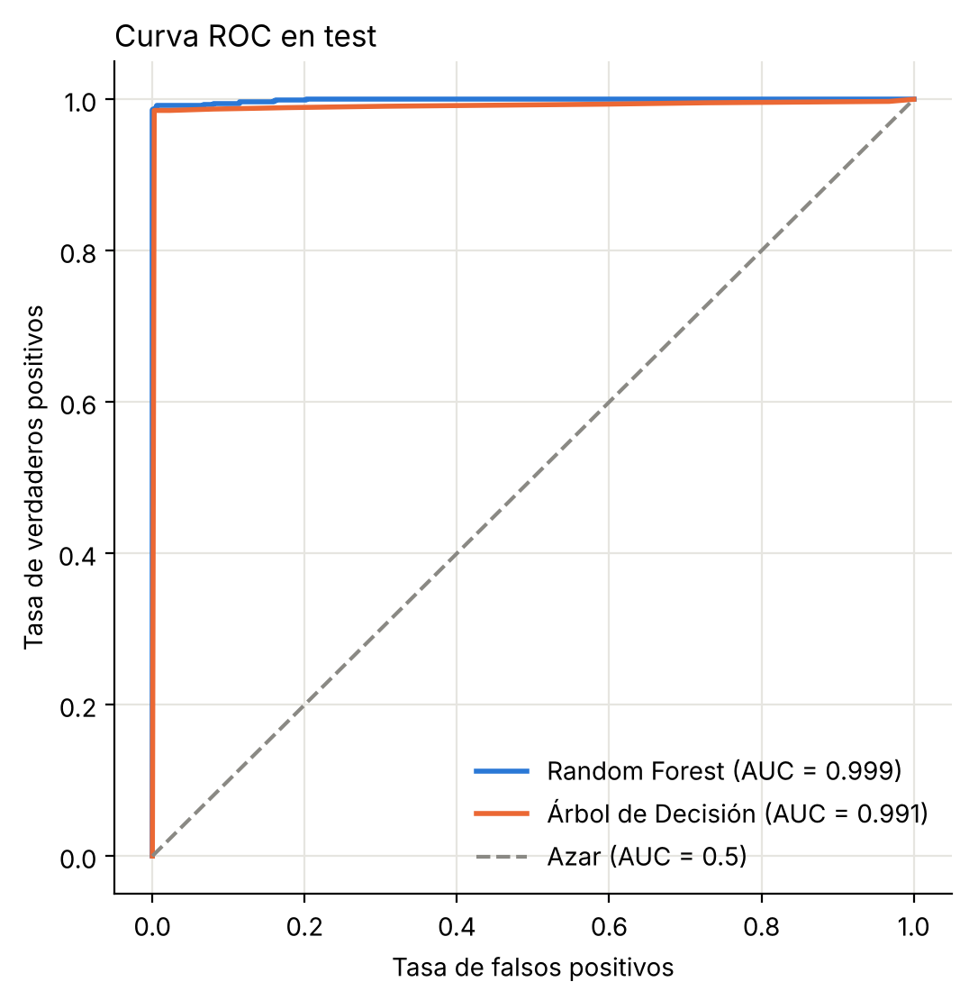
  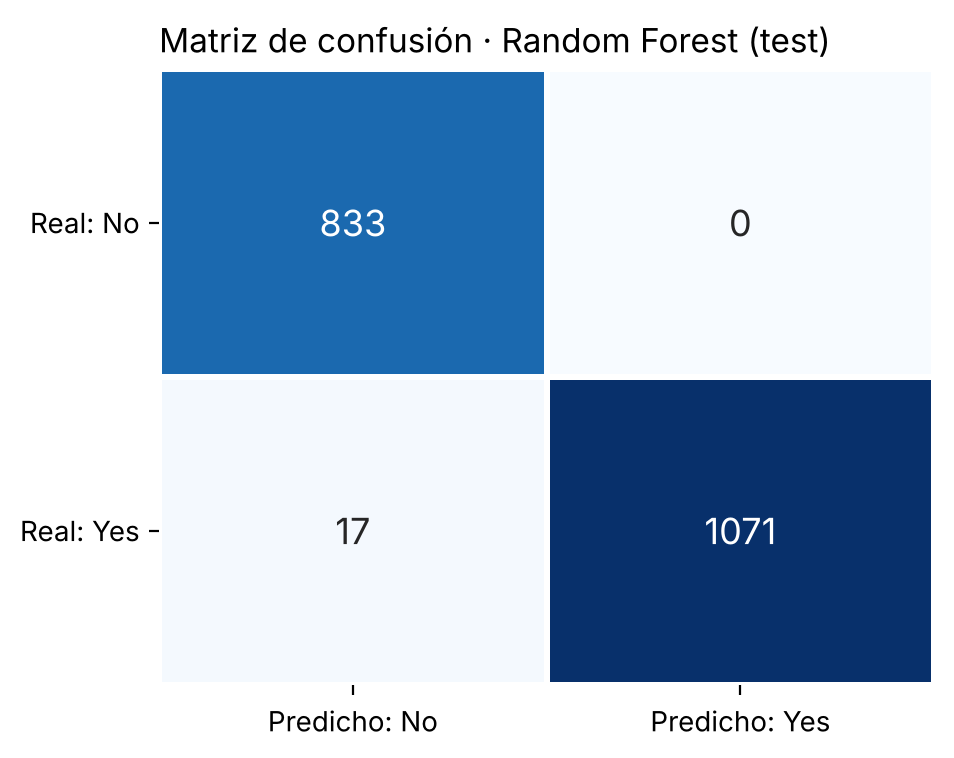
</p>

## Hallazgos principales

<p align="center">
  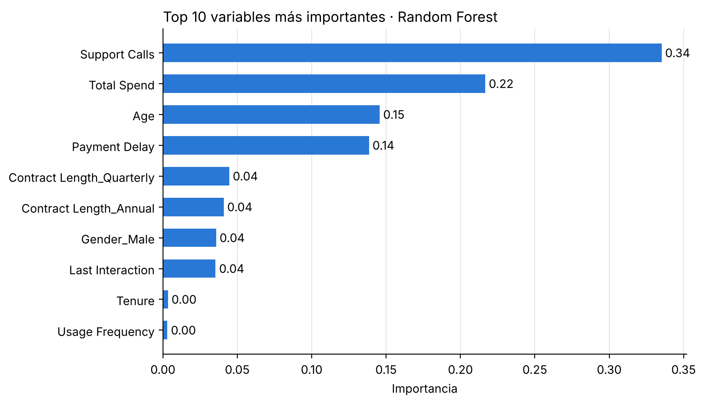
</p>

| Variable (media) | Se queda | Se va |
|---|---|---|
| Llamadas a soporte | 1,6 | **5,1** |
| Retraso en el pago (días) | 10,0 | **15,3** |
| Gasto total | 749,9 | **544,4** |
| Edad | 36,0 | **41,7** |

- **Las llamadas a soporte son la variable más determinante.** Los clientes que se van llaman a atención al cliente tres veces más que los que se quedan.
- **El gasto total y el retraso en los pagos** son la segunda y tercera señal más importante.
- **El tipo de tarifa, la antigüedad y la frecuencia de uso apenas influyen.** La tasa de churn por tarifa va del 55 % al 58 %.
- **Los contratos largos retienen:** los anuales y trimestrales tienen un churn del 45–47 %, frente al 100 % de los mensuales.

<p align="center">
  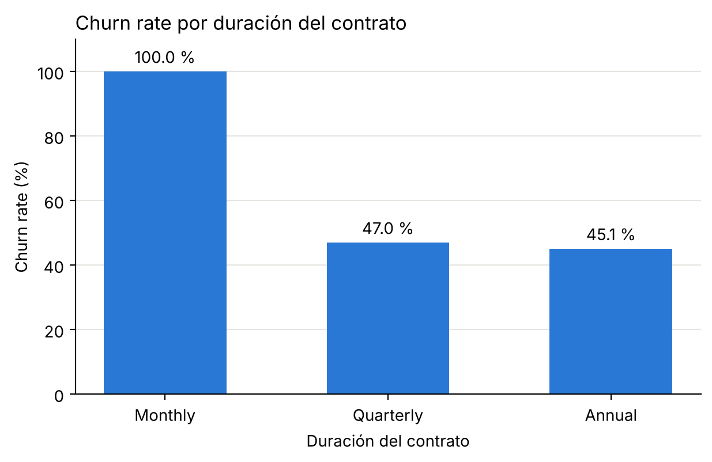
  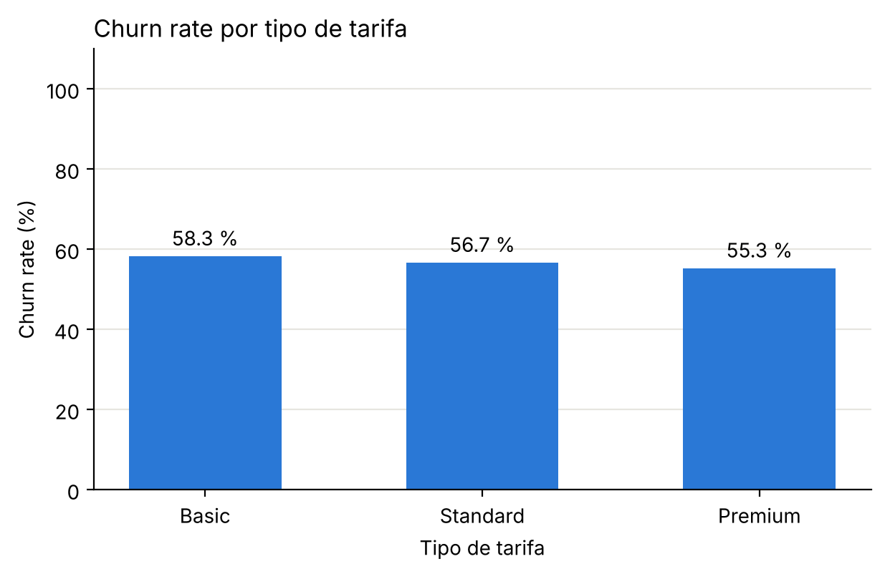
</p>

## Segmentación por riesgo

La probabilidad de churn se traduce en tres niveles accionables para el equipo de retención:

| Nivel | Probabilidad | Clientes en test | % que realmente se fue |
|---|---|---|---|
| Alto riesgo | ≥ 0,75 | 1.051 | 100 % |
| Riesgo medio | 0,40 – 0,75 | 25 | 92 % |
| Sin riesgo | < 0,40 | 845 | 1,7 % |

El notebook exporta `output/predicciones_churn_powerbi.csv`, con el ID del cliente, el churn real, la predicción, la probabilidad, el nivel de riesgo y si el cliente estaba en train o en test. Ese fichero alimenta el dashboard de Power BI.

## Dashboard en Power BI

El informe de Power BI ([`powerbi/dashboard_churn.pbix`](powerbi/dashboard_churn.pbix)) tiene 11 páginas y sirve de soporte para la defensa del proyecto:

- **KPIs con medidas DAX:** total de clientes, clientes perdidos, tasa de retención, gasto medio y media de llamadas a soporte.
- **Análisis de churn** por tarifa y por duración del contrato, y perfil de los clientes activos frente a los que se van.
- **Estadística descriptiva y matriz de correlación.**
- **Comparativa de modelos:** Random Forest frente a Árbol de Decisión (curvas ROC de train y test).
- **Buscador de clientes:** a partir del ID muestra la probabilidad de churn y un semáforo de riesgo.
- **Impacto en el negocio y recomendaciones**, con la distribución de clientes por nivel de riesgo.


<p align="center">
  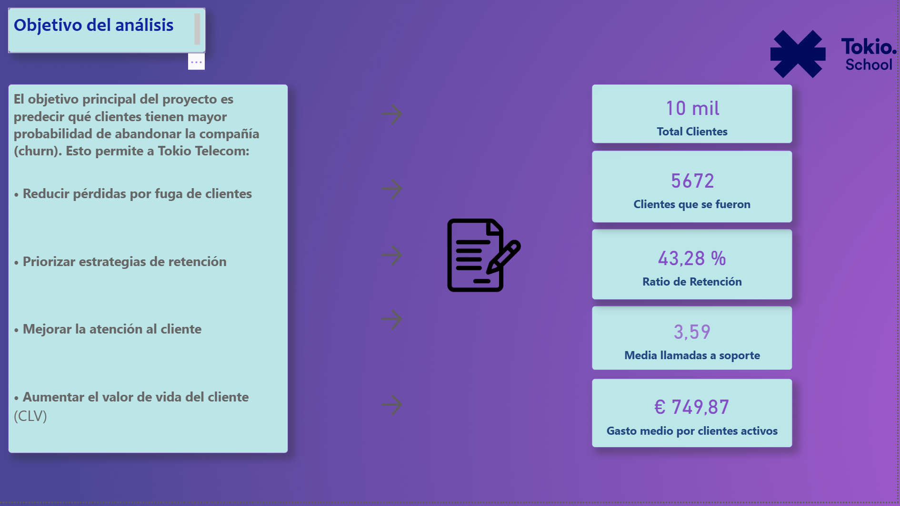
  
  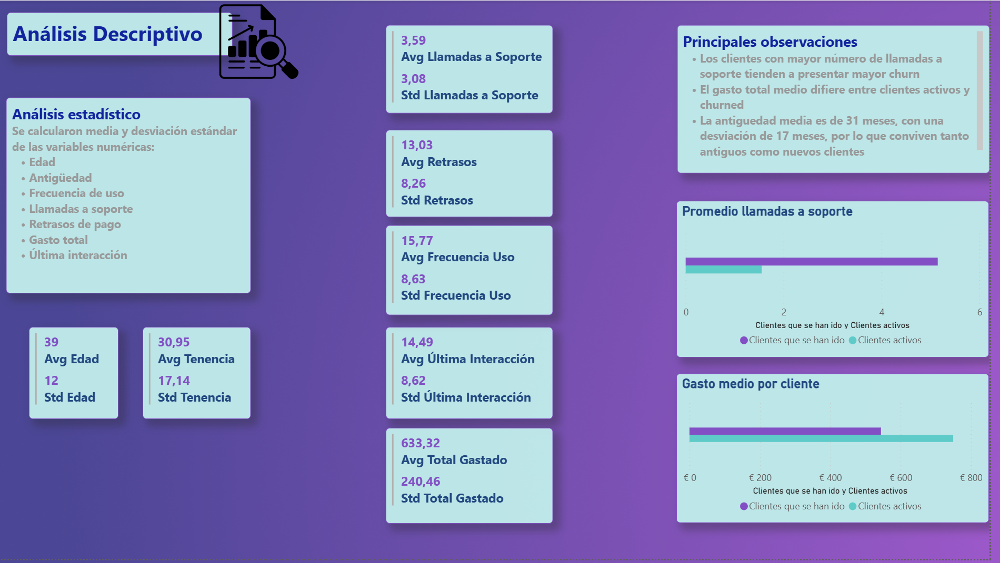
  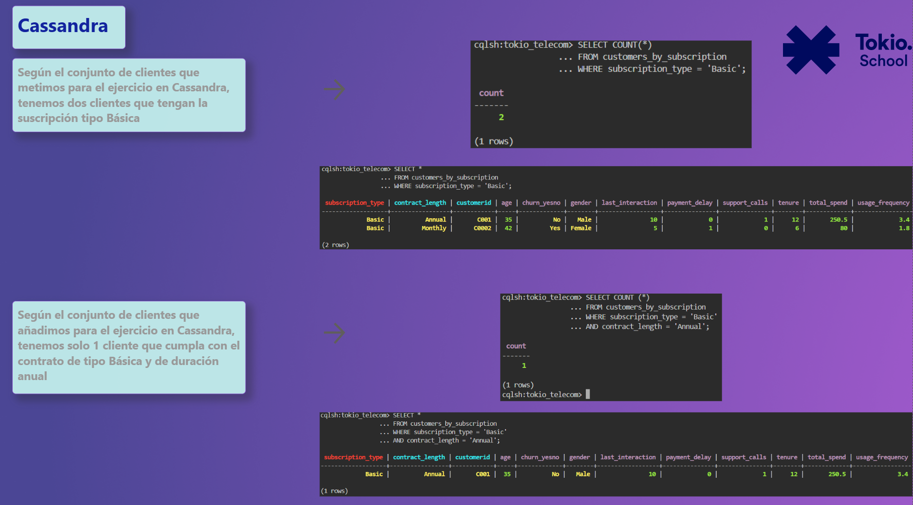
  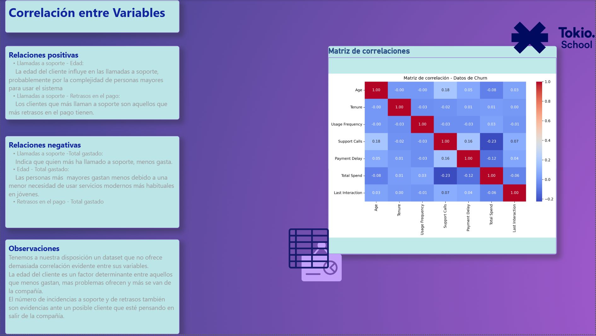
  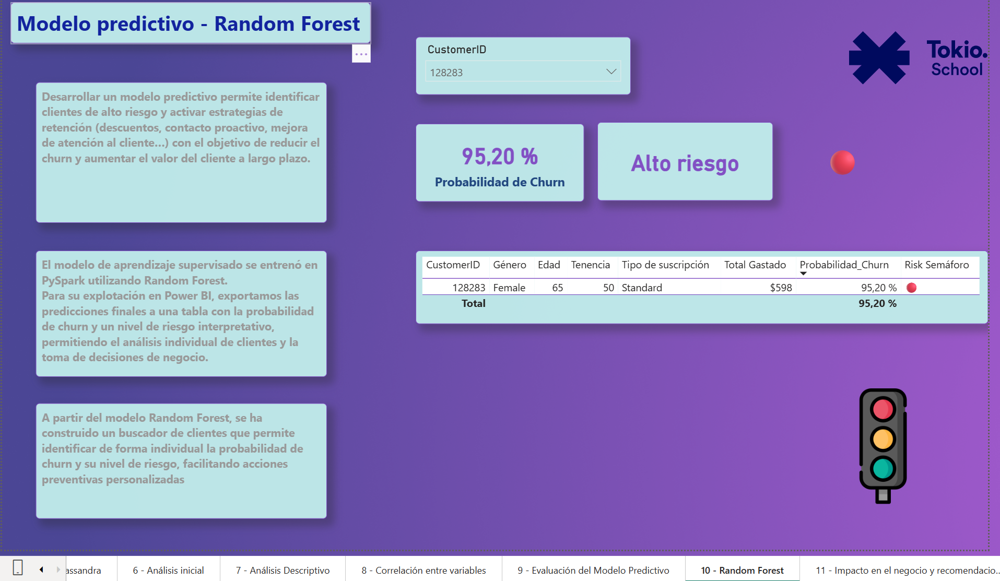
  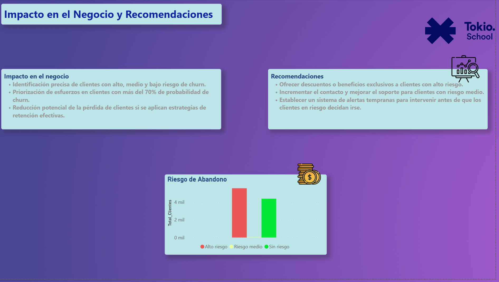
 
  
 
</p>
-->

## Ejercicio complementario: Cassandra

Como parte del proyecto, se modeló una tabla `customers_by_subscription` en **Apache Cassandra**, con `subscription_type` y `contract_length` como claves, y se consultó con CQL sobre un pequeño conjunto de clientes de prueba.

<p align="center">
  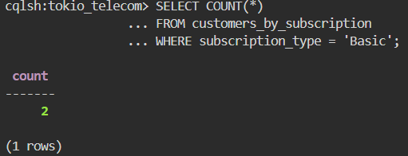
  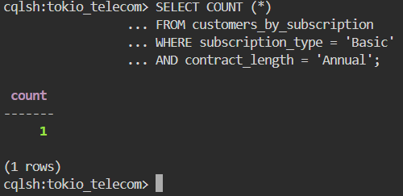
</p>

## Estructura del repositorio

```
├── data/
│   └── customer_churn_10k.csv        # dataset original (10.000 clientes)
├── notebooks/
│   └── churn_analysis.ipynb          # análisis completo y modelos
├── powerbi/
│   └── dashboard_churn.pbix          # dashboard / presentación de la defensa
├── docs/
│   └── informe_proyecto.pdf          # informe entregado en el máster
├── images/                           # gráficas del notebook y capturas de Cassandra
├── output/
│   └── predicciones_churn_powerbi.csv
└── requirements.txt
```

## Cómo ejecutarlo

Necesitas **Python 3.10+** y **Java 17 o superior** (PySpark lo necesita).

```bash
git clone https://github.com/kanteblanco/churn-prediction-pyspark.git
cd churn-prediction-pyspark
python -m venv .venv && source .venv/bin/activate   # en Windows: .venv\Scripts\activate
pip install -r requirements.txt
jupyter notebook notebooks/churn_analysis.ipynb
```

La ejecución completa tarda unos 3–4 minutos en un portátil (la parte más lenta es el Grid Search).

## Nota sobre las versiones

El informe (`docs/`) y el dashboard (`powerbi/`) se entregaron con el máster y se conservan tal cual. El notebook es una **versión revisada** posterior a esa entrega: incluye la prueba de robustez, métricas de precisión y recall, y una segmentación de riesgo calculada sobre test. Por eso algunas cifras pueden diferir ligeramente entre documentos. Por ejemplo, el informe cuenta 5.554 clientes de alto riesgo porque puntúa los 10.000 clientes, incluidos los que se usaron para entrenar.

## Limitaciones

El dataset es **sintético**: tiene una tasa de churn del 56,7 % y unas clases muy bien separadas, nada realista para una operadora. Por eso las métricas son casi perfectas. Con datos reales cabría esperar resultados más bajos, y habría que validar el modelo con clientes de periodos posteriores al entrenamiento.

---

**Roberto Peña Alcaide** · Data Analyst · Castellón / Valencia
